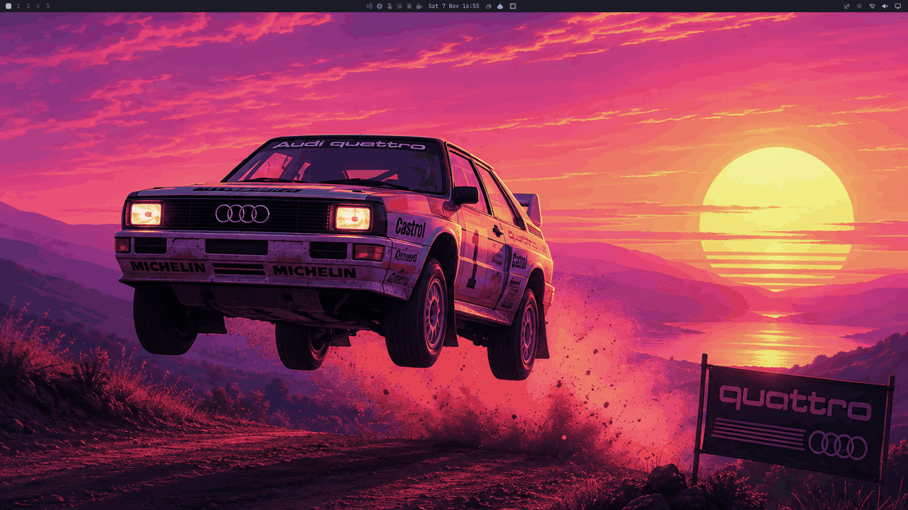
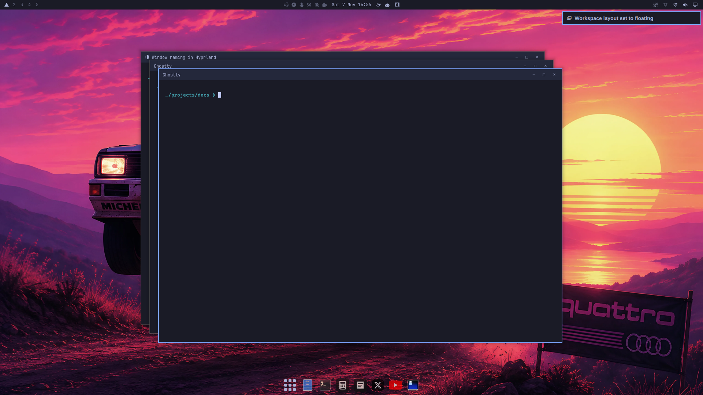

# omatitles

A titlebar with the **window's own title** above your agent and terminal
windows on [Omarchy](https://omarchy.org), so a screen full of Claude sessions
and remote terminals is readable at a glance. Colored from your theme. No
compiled plugin, so a Hyprland update can't break it.



Claude Code writes its session summary into the window title (`◑ Window naming
in Hyprland`), and herdr writes `<host>: <session>` (`devbox: api`). Those
titles are the useful name of the window. Hyprland just never shows them.

## How it works

Hyprland has no titlebar. But it draws a **groupbar** above any window in a
group, and it does that even for a group of one. omatitles opens every matching
window as its own group:

```lua
o.window({ class = cfg.class }, { group = "new always" })
```

That's the whole trick. The rest of `omatitles.lua` makes it survivable and
makes it look right.

### Groups that only form on purpose

With every terminal now a group, Hyprland's group behaviour wakes up. Four
defaults have to go:

| Setting | Default | Why it has to go |
|---|---|---|
| `middle_click_close` | `true` | Middle-click on a groupbar closes the window. Middle-click is also the paste gesture, so one stray click kills a live agent session. |
| `auto_group` | `true` | New windows join the focused group: Telegram opened while a terminal had focus becomes a tab of it. |
| `drag_into_group` | `1` | Dragging a window onto another merges them into tabs. |
| `merge_groups_on_drag` / `_on_groupbar` | `true` | Groups merge into each other on drag. |

Tabs still work, on purpose: `SUPER + G`, or `SUPER + ALT + <arrow>` to pull a
neighbour in. `SUPER + G` on a single window also takes its bar off, and it
stays off, across reloads too.

### Colors from the theme

The bar takes the theme's active border color for the focused window and the
inactive border color for the rest. The text is black or white, whichever reads
on that color, so light themes don't get white on pale. `omarchy theme set`
reloads Hyprland, and the colors follow. The font is `monospace`, so
`omarchy font set` changes it too.

### Floating workspaces (Omarchy 4.5+)

Omarchy 4.5 floats whole workspaces (`SUPER + L`) and draws its own titlebars
there, with minimize, maximize and close buttons. Two bars would stack, so
omatitles steps aside: a window on a floating workspace loses its groupbar and
gets it back when it's tiled again. Tabs you made yourself are left alone.



Omarchy's titlebar names the app when one claims the window (`Ghostty`), not
the title. That's why tiled terminals still need omatitles.

## Requirements

Omarchy 4 ("Quattro") or later, with the Lua Hyprland config
(`~/.config/hypr/hyprland.lua`). omatitles uses Omarchy's `o.window` helper and
Hyprland's `hl` Lua API, so it won't work with the old `hyprland.conf` setup.
It's tested on Omarchy 4.0.6 and 4.5.

## Install

```bash
curl -fsSL https://raw.githubusercontent.com/lcorneliussen/omatitles/main/install.sh | bash
```

This clones the repo into `~/.local/share/omatitles` and appends a loader to
`~/.config/hypr/hyprland.lua`. Hyprland picks up the change on save. Windows
that are already open get their bar then too.

Run it again to update. Running `./install.sh` from a checkout links the
checkout instead, which is handy for hacking on it, or for a dotfiles repo that
carries this one as a submodule.

To uninstall, delete the loader lines at the end of `hyprland.lua` and
`~/.local/share/omatitles`, then reload.

## Options

Pass them to `setup()` in the loader line in `hyprland.lua`:

```lua
...omatitles.lua").setup({
  -- Which windows get a bar: a Hyprland class regex.
  class = "^(org\\.omarchy\\.agent|com\\.mitchellh\\.ghostty|Alacritty|kitty|foot|org\\.codeberg\\.dnkl\\.foot)$",
  font_size = 13,
  height = 24,
  active_alpha = 0xdd,   -- bar opacity, 0-255
  inactive_alpha = 0xcc,
})
```

Pick windows whose title is already a useful name. Browsers are left out on
purpose: their titles run past 100 characters and the bar becomes noise.

## Tips

`hyprctl dispatch` needs call parentheses with the Lua config, and `ok` is not
proof that anything happened:

```bash
hyprctl dispatch 'hl.dsp.group.toggle()'   # works
hyprctl dispatch hl.dsp.group.toggle       # returns "ok" and does nothing
```

## Tests

`tests/run.sh` runs end-to-end tests in an
[omabox](https://github.com/diogochaves/omabox) box: a private, headless
Hyprland + Omarchy desktop. Nothing touches your real session. The script runs
the real `install.sh`, opens real windows, and reads groups and tags back
through `hyprctl`. It covers the settings, windows open before the install,
matching and non-matching windows, a bar taken off with `SUPER + G`, and the
handover on floating workspaces.

```bash
tests/run.sh                          # against the installed Omarchy
OMARCHY=~/src/omarchy tests/run.sh    # against an Omarchy checkout
KEEP_BOX=1 tests/run.sh               # leave the box up afterwards
```

`scripts/readme-media.sh` makes the images in this README the same way, in a
box with staged titles.

## License

MIT
